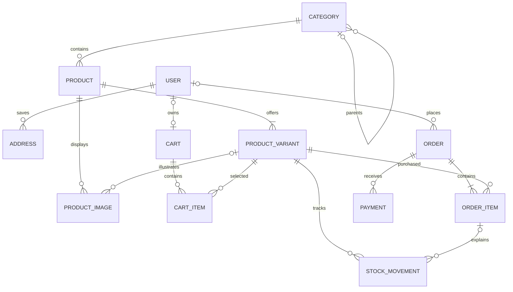

# Small-shop ecommerce: model design

Proposed first version: **12 application models**. This is a design document;
it does not describe models already implemented. Django authentication/session
tables are additional framework tables.

## Scope and assumptions

- One shop, one stock location, physical products, and one configured currency.
- Customers can register or check out as guests. Staff use the existing User model.
- One category per product; categories can have subcategories.
- Every product has at least one variant. Products without options have a default variant.
- Cash on delivery and manually verified payments initially. Online gateway integration
  needs provider-specific endpoints later.
- One delivery per order; a configured flat delivery fee initially. Courier and tracking
  details live on the order.
- Staff handle returns and full refunds manually. Partial monetary refunds, exchanges,
  promotions, multiple warehouses, and supplier purchasing are outside this first version.
- Tax calculation depends on the shop's requirements and must be settled before checkout
  implementation. The order reserves a tax amount field; zero is valid when applicable.

## Conventions

- Every model has an automatically generated BigAutoField `id`.
- Money fields use DecimalField(max_digits=12, decimal_places=2), never float.
- `required` means non-null; optional text is stored as an empty string.
- Timestamps use timezone-aware DateTimeField.
- Foreign keys below include intended deletion behavior.
- Statuses and fixed choices use Django TextChoices, not additional tables.

## 1. User — users app

Keep the existing custom model extending AbstractUser. Its inherited fields include
`username`, hashed `password`, `first_name`, `last_name`, `email`, `is_active`,
`is_staff`, `is_superuser`, `last_login`, and `date_joined`.

| Field | Type / rule |
|---|---|
| email | EmailField; required and unique for account recovery |
| mobile_number | CharField(20); required; not assumed unique |

Use username and password for login. Normalize emails consistently before uniqueness
checks. Use Django password hashing and permissions. No Customer or Staff model is needed.
The current single `User.address` field is replaced by saved Address records when this
design is implemented; preserve existing address data through a migration if needed.

## 2. Address — users app

| Field | Type / rule |
|---|---|
| user | FK User, CASCADE; related_name=addresses |
| recipient_name | CharField(150); required |
| phone | CharField(20); required |
| address_line | TextField; required |
| area | CharField(100); optional |
| city | CharField(100); required |
| postal_code | CharField(20); optional |
| country_code | CharField(2); required |
| created_at | DateTimeField; automatic on creation |
| updated_at | DateTimeField; automatic on update |

Multiple addresses per user. The customer explicitly chooses an address at checkout;
there is no default-address mechanism in this version.

## 3. Category — catalog app

| Field | Type / rule |
|---|---|
| name | CharField(100); unique |
| slug | SlugField(120); unique |
| parent | Optional FK self, PROTECT; related_name=children |
| is_active | BooleanField; default true |
| created_at | DateTimeField; automatic on creation |
| updated_at | DateTimeField; automatic on update |

Prevent self-parenting and category cycles. A category referenced by products or child
categories cannot be deleted. Products in inactive categories are not purchasable.

## 4. Product — catalog app

| Field | Type / rule |
|---|---|
| category | FK Category, PROTECT; related_name=products |
| name | CharField(200); required |
| slug | SlugField(220); unique |
| description | TextField; optional |
| is_active | BooleanField; default false until ready to sell |
| created_at | DateTimeField; automatic on creation |
| updated_at | DateTimeField; automatic on update |

Price and stock belong to variants. Product creation creates its initial variant in
the same transaction. A product must have an active variant before publication.
Archive previously sold products rather than deleting them.

## 5. ProductVariant — catalog app

| Field | Type / rule |
|---|---|
| product | FK Product, CASCADE; related_name=variants |
| sku | CharField(64); unique |
| options | JSONField; default empty dict, e.g. {"color": "Black", "size": "M"} |
| price | DecimalField; required, nonnegative |
| stock_quantity | PositiveIntegerField; default 0 |
| is_active | BooleanField; default true |
| created_at | DateTimeField; automatic on creation |
| updated_at | DateTimeField; automatic on update |

An empty options dictionary identifies a default variant. Options are a small map of
nonempty string names to nonempty string values. Reject duplicate option combinations
within a product, including multiple default variants. Serialize variant mutations by
locking the product row so concurrent requests cannot create duplicates.

Stock is changed through stock services, never through ordinary variant updates.
Archive a variant once it appears in an order or stock history; those references protect
it from deletion. Do not remove the last variant from a product.

## 6. ProductImage — catalog app

| Field | Type / rule |
|---|---|
| product | FK Product, CASCADE; related_name=images |
| variant | Optional FK ProductVariant, CASCADE; related_name=images |
| image | ImageField; required; storage location configured outside the model |
| alt_text | CharField(200); optional |
| position | PositiveIntegerField; default 0 |
| created_at | DateTimeField; automatic on creation |

A product has many images even without variants. Null variant means a general product
image. A supplied variant must belong to the same product. Sort by position, then id;
the first image is the main image. Variant-specific galleries fall back to general images.
This simple design assigns an image to at most one variant; sharing a color gallery
across sizes is a catalog requirement to confirm before implementation.

## 7. Cart — cart app

| Field | Type / rule |
|---|---|
| user | Optional OneToOneField User, CASCADE; related_name=cart |
| guest_token_hash | CharField(64); nullable and unique |
| created_at | DateTimeField; automatic on creation |
| updated_at | DateTimeField; automatic on update |

Exactly one of user or guest_token_hash must be present, enforced by a database check.
Authenticated customers have one current cart. Guests receive a securely generated cart
token; store its hash, and never accept a cart id alone as proof of ownership.
Cart contents do not reserve stock. Guest-cart merging is deferred; signing in uses the
account cart and the guest can still complete guest checkout separately.

## 8. CartItem — cart app

| Field | Type / rule |
|---|---|
| cart | FK Cart, CASCADE; related_name=items |
| variant | FK ProductVariant, CASCADE; related_name=cart_items |
| quantity | PositiveIntegerField; required, database check greater than zero |
| created_at | DateTimeField; automatic on creation |
| updated_at | DateTimeField; automatic on update |

Unique database constraint on (cart, variant). Prices and line totals are calculated
from current variant prices; they are not stored on cart items. Checkout revalidates
availability, prices, quantities, and delivery charges.

## 9. Order — orders app

| Field | Type / rule |
|---|---|
| number | UUIDField; unique, generated, public order reference |
| checkout_key | UUIDField; unique; required client retry key |
| user | Optional FK User, SET_NULL; related_name=orders |
| guest_access_token_hash | CharField(64); nullable and unique |
| customer_name | CharField(150); required snapshot |
| customer_email | EmailField; optional snapshot |
| customer_phone | CharField(20); required snapshot |
| delivery_address_line | TextField; required snapshot |
| delivery_area | CharField(100); optional snapshot |
| delivery_city | CharField(100); required snapshot |
| delivery_postal_code | CharField(20); optional snapshot |
| delivery_country_code | CharField(2); required snapshot |
| status | pending, confirmed, shipped, delivered, cancelled, returned; default pending |
| currency | CharField(3); snapshot of shop currency |
| subtotal | DecimalField; sum of order item line totals |
| delivery_fee | DecimalField; nonnegative |
| tax_total | DecimalField; nonnegative |
| total | DecimalField; subtotal + delivery_fee + tax_total |
| customer_note | TextField; optional |
| courier_name | CharField(100); optional |
| tracking_number | CharField(100); optional |
| created_at | DateTimeField; automatic on creation |
| updated_at | DateTimeField; automatic on update |

Saved addresses are copied into these fields. Orders do not depend on mutable Address
records. The server calculates monetary fields. Guest lookup requires both order number
and a separate secret token; an order reference alone is not authorization.

Checkout locks the cart and relevant variant rows, verifies stock, creates order/items
and the initial Payment, deducts stock with StockMovement entries, and clears cart items
in one transaction. The checkout key prevents duplicate orders on retries; it must be
scoped to the authorized checkout owner when retrieving an existing result.

Allowed flow: pending -> confirmed -> shipped -> delivered. Pending/confirmed orders
can be cancelled and have stock restored once. Delivered orders can become returned
when all quantities have been returned. Partial item returns leave status delivered;
returned quantities are visible on order items. Shipped orders cannot use cancellation.

## 10. OrderItem — orders app

| Field | Type / rule |
|---|---|
| order | FK Order, PROTECT; related_name=items |
| variant | FK ProductVariant, PROTECT; related_name=order_items |
| product_name | CharField(200); purchase-time snapshot |
| sku | CharField(64); purchase-time snapshot |
| variant_options | JSONField; purchase-time snapshot |
| unit_price | DecimalField; purchase-time snapshot, nonnegative |
| quantity | PositiveIntegerField; database check greater than zero |
| line_total | DecimalField; unit_price multiplied by quantity |
| returned_quantity | PositiveIntegerField; default 0; at most quantity |

One row per variant per order, enforced by a unique constraint. Snapshots are immutable
after checkout. Only the return service updates returned_quantity. Orders and their
items are retained for purchase history; no order deletion endpoint is provided.

## 11. Payment — orders app

| Field | Type / rule |
|---|---|
| order | FK Order, PROTECT; related_name=payments |
| method | cod or manual |
| status | pending, succeeded, failed, cancelled, refunded; default pending |
| amount | DecimalField; positive; full order total |
| currency | CharField(3); copied from order |
| reference | CharField(150); optional collection/transfer reference |
| note | TextField; optional staff payment note |
| paid_at | Optional DateTimeField |
| refunded_at | Optional DateTimeField |
| refund_reference | CharField(150); optional |
| refund_note | TextField; optional |
| recorded_by | Optional FK User, SET_NULL; related_name=recorded_payments |
| refunded_by | Optional FK User, SET_NULL; related_name=recorded_refunds |
| created_at | DateTimeField; automatic on creation |
| updated_at | DateTimeField; automatic on update |

An order can have multiple attempts, but at most one pending or succeeded payment,
enforced by a conditional unique constraint. Checkout creates a pending payment.
Staff settle that record or mark it failed/cancelled before creating a retry. COD
collection is recorded as succeeded when actually collected. Zero-total orders are
outside this initial scope because discounts/free orders are not included.

Refunding records a full refund already performed manually; it does not transfer money.
Only a succeeded payment on a cancelled or fully returned order can be refunded.
Refund recording does not change stock. Partial monetary refunds need a separate Refund
model later. Derive the order's payment state from its payments; do not maintain a second
independently editable payment status on Order.

## 12. StockMovement — catalog app

| Field | Type / rule |
|---|---|
| variant | FK ProductVariant, PROTECT; related_name=stock_movements |
| order_item | Optional FK OrderItem, PROTECT; related_name=stock_movements |
| quantity_change | IntegerField; nonzero signed change |
| reason | received, sale, cancellation, return, damage, correction |
| note | TextField; required for manual corrections |
| created_by | Optional FK User, SET_NULL; related_name=stock_movements |
| created_at | DateTimeField; automatic on creation |

Positive values add stock; negative values remove stock. Stock movements are append-only.
Opening stock is a received movement. Every change updates variant.stock_quantity and
creates a movement in the same transaction while locking the variant row. Stock cannot
become negative. Sale/cancellation/return movements reference the relevant order item.

Cancellation restores each item's stock exactly once. Return processing increments
returned_quantity under a lock; it cannot exceed purchased quantity. Restock only units
that staff marks resellable, recording their positive return movements. Damaged returned
units increase returned_quantity but do not increase available stock.

## Relationship summary

## Implementation order and acceptance checks

1. Users and catalog: verify ownership, unique SKUs, valid category trees, and variant images.
2. Stock and cart: verify nonnegative stock, movement history, and isolated guest/user carts.
3. Checkout: verify immutable snapshots, concurrent stock purchases, retry safety, and rollback.
4. Fulfillment/payment: verify allowed transitions, cancellation restores once, returns cannot
   exceed purchased quantities, and duplicate collection/refund requests do not duplicate effects.

Before implementation, confirm product types/options, shared variant images, currency,
tax/delivery rules, and actual payment methods with the shop owner.
